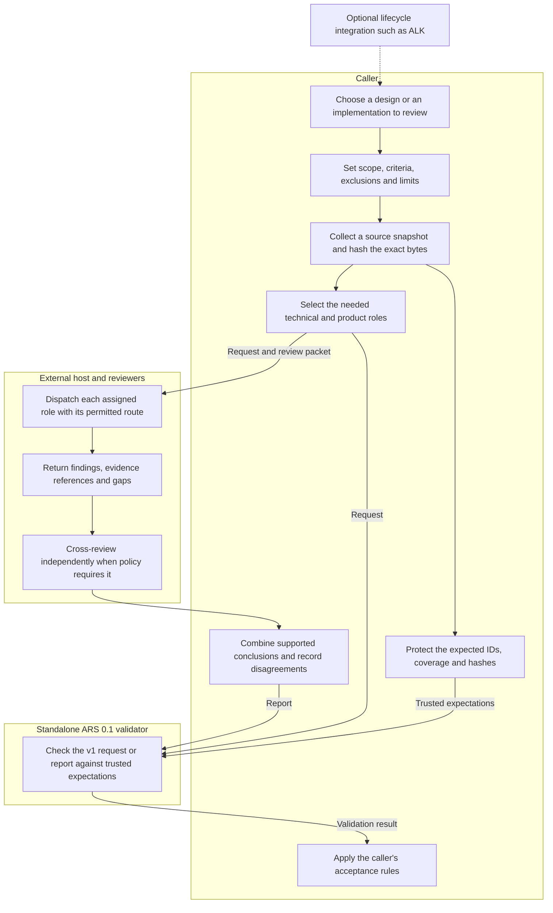

# Standalone review architecture

[Русский](../ru/architecture/c0-c4.md)

ARS checks review documents. A caller can use it from a script, a software delivery
process, or a lifecycle tool such as ALK. The caller owns the decision.

## One review

The caller chooses only the roles it needs. For example, a design review can
check architecture and product fit. A code review can check tests and resource
limits. The caller sets the route and budget for each role. The host runs each
role with its permitted tools. Reviewers record facts, gaps, practical fixes and
alternatives. The caller combines findings by evidence and scope. It retains
unresolved disagreements and uses a reasoned recommendation without voting.

If a correction changes only the installation example, the caller can ask the
affected role to recheck the example. For a shared contract change, it covers
each affected role. If the impact is unknown, it covers the full scope that the
policy requires. Required acceptance and final checks still apply.

## What v1 implements

| View | ARS 0.1.0 |
| --- | --- |
| Landscape | A person, software delivery process, or lifecycle tool coordinates the review. |
| Context | The caller supplies a v1 request or report and separate trusted expectations. |
| Containers | The Python package provides a bytes API and a bounded CLI. Skills provide guidance for external hosts. |
| Components | The CLI reads staged inputs. The contract validator checks shape, semantics and bindings. |
| Interfaces | Use `validate_bytes` or `python -m agent_review_suite validate`. Use the three v1 schema files for field checks. |

For example, the validator can check that a report covers the IDs the caller
required. The caller still checks the evidence behind each finding and decides
whether to accept the work.

The caller can perform inventory, pack selection, dispatch and synthesis with
its own tools. ARS automation for review packs, evidence handling and host
bridges belongs to later work. See the [roadmap](../roadmap.md).

See [contracts](../reference/request-report.md),
[caller integration](../reference/integration.md), and the [threat model](threat-model.md).
