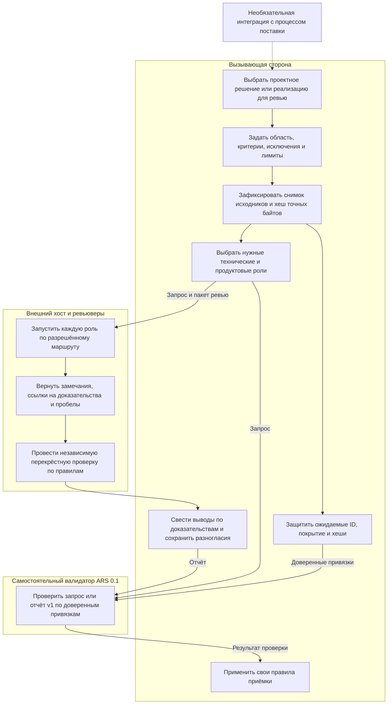

# Архитектура самостоятельного ревью

[English](../../architecture/c0-c4.md)

ARS проверяет документы ревью. Его может вызвать скрипт, процесс поставки
ПО или инструмент управления процессом. Решение принимает вызывающая
сторона.

## Одно ревью

Вызывающая сторона выбирает только нужные роли. Например, ревью проектного
решения может проверить архитектуру и соответствие продуктовой задаче. Ревью
кода может проверить тесты и пределы ресурсов. Вызывающая сторона задаёт
маршрут и бюджет каждой роли. Хост запускает роли с разрешёнными инструментами.
Ревьюверы фиксируют факты, пробелы, практические исправления и варианты.
Вызывающая сторона сводит выводы по доказательствам и области проверки. Она
сохраняет открытые разногласия и формирует обоснованную рекомендацию без
голосования.

Если исправление меняет только пример установки, вызывающая сторона может
попросить затронутую роль проверить пример. Изменение общего контракта
проверяют все затронутые роли. При неизвестном влиянии проверяют весь объём,
который требуют правила. Обязательные проверки приёмки и завершения сохраняются.

## Что реализует v1

| Уровень | ARS 0.1.0 |
| --- | --- |
| Окружение | Ревью координирует человек, процесс поставки ПО или инструмент жизненного цикла. |
| Контекст | Вызывающая сторона передаёт запрос или отчёт v1 и отдельные доверенные привязки. |
| Контейнеры | Пакет Python предоставляет API для байтов и CLI с ограниченным вводом. Скиллы дают инструкции внешним хостам. |
| Компоненты | CLI читает подготовленные входы. Валидатор проверяет структуру, правила документа и привязки. |
| Интерфейсы | Используйте `validate_bytes` или `python -m agent_review_suite validate`. Для проверки полей используйте три файла схем v1. |

Например, валидатор проверяет, что отчёт охватывает все ID, заданные вызывающей
стороной. Она отдельно проверяет доказательства по каждому замечанию и решает,
можно ли принять работу.

Вызывающая сторона может собирать список исходников, выбирать пакеты, запускать
ревью и сводить выводы своими средствами. Автоматизация пакетов ревью, работа с
доказательствами и интеграции с хостами описаны в [дорожной карте](../roadmap.md).

См. [контракты](../reference/request-report.md),
[интеграцию](../reference/integration.md) и [модель угроз](threat-model.md).
